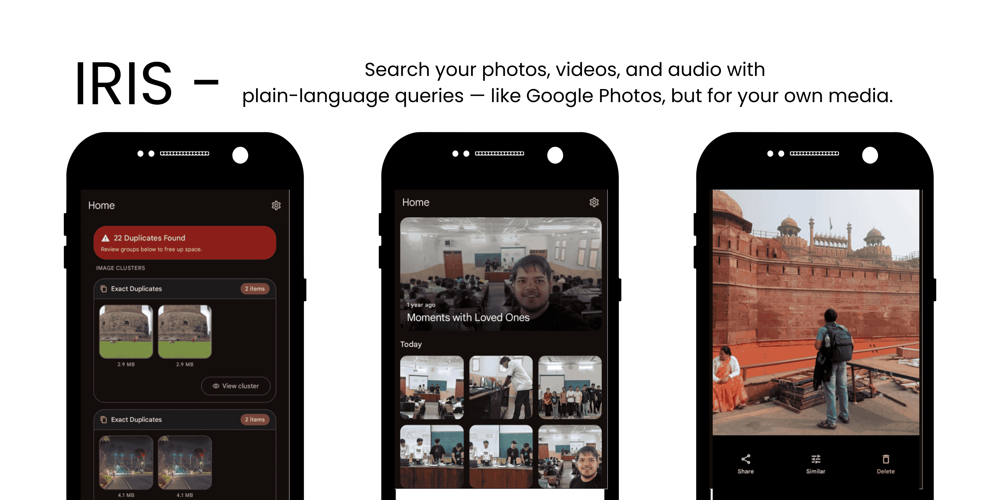
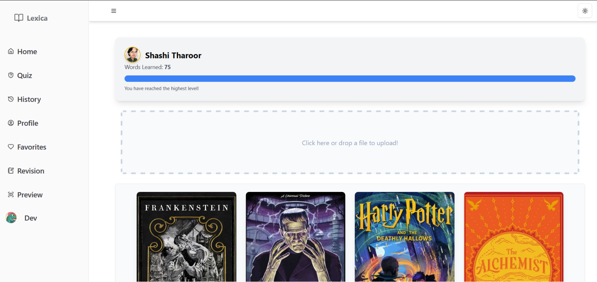

# Rajat Shukla 
# SDE/AI Engineering | Competitive Programmer

### About Me

MCA student at MNNIT Allahabad (2027), building fullstack and ML-integrated systems. Competitive programmer — Top 5% on LeetCode globally, Top 1% on individual contests. Currently looking for SDE1 / AI-engineering internships and roles.

🔭 **Currently:** Open to off-campus SDE1 / AI-engineering internships — happy to talk backend systems, ML integration, or competitive programming.

---

### Featured Projects

### [IRIS](https://github.com/TeliarganjTesters/iris) — Image Recognition and Indexing Service

A self-deployed, privacy-focused alternative to Google Photos — one that searches across text, image, audio, and video using a unified embedding space, without handing your media over to a third party. Hybrid search fuses CLIP vector similarity, YOLOv8 object matching, and OCR text overlap; an async pipeline (Celery + Redis) orchestrates 4 ML models per upload with two-tier duplicate detection.

Tech Stack: `FastAPI` `PostgreSQL + pgvector` `Celery` `Redis`
Models used: `CLIP` `YOLOv8` `Whisper` `EfficientNet`

### [Lexica](https://github.com/mummykelaadle/lexica) — Vocabulary Learning App with quizes

A MERN-stack book reading companion that turns books into scrollable word feed — enabling easy, in-flow word lookups so you never have to break your reading momentum. Powered by a custom word-difficulty scoring formula, it includes a quiz system that builds your vocabulary by targeting challenging words based on your performance.
📈 Reduced PDF processing time by **96.97%** via parallel processing

Tech Stack: `MongoDB` `Express` `React` `Node.js` `Typescript`

---

### Achievements

| | |
|---|---|
| 🏆 LeetCode | Top 5% globally · Top 1% individual contest rank (324/28,885, Weekly Contest #475) |
| 🥈 EY Techathon 6.0 (2025) | Top 2.5% of 1,83,000+ teams — Agentic Retail track |
| 🥇 Hack36 Hackathon | 10th place out of 350+ teams (MNNIT Allahabad, national-level) |
| 🥈 DevJam Hackathon | Runner-up among 82+ teams |
| 🥈 Dev Or Die Hackathon | First runner-up among 42+ teams |
| 🥈 Smart India Hackathon | 2nd place, internal college round (2025) |
| 🌱 Hacktoberfest 2024 | 4 PRs merged across 8 open-source projects |

---

### Skills & Technologies

---

### Reach Me

### P.S. - HacktoberFest 2024 - Holopins ✨

Hacktoberfest is an annual celebration of open-source software, encouraging contributions and collaboration within the community. During the 2024 event, I was awarded pins for completing **4 pull requests** in **open source projects** and contributed to a total of **8 open source projects**!

